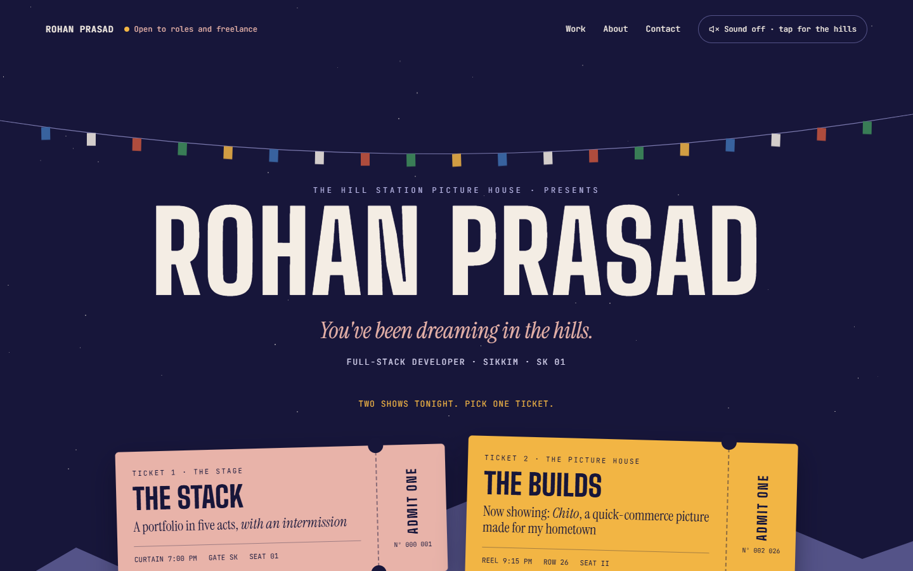

# The Hill Station Picture House

The portfolio of **Rohan Prasad**, a full-stack developer from Sikkim, told as a night at a vintage
hill-station cinema.

**Live site: https://rohanprasad.vercel.app**



## Pages
- `/` **Box office**: prayer flags, stars, three mountain ridges and two tickets to pick from
- `/stack` **Ticket 1, The Stack**: the story in five acts, an intermission, and contact
- `/builds` **Ticket 2, The Builds**: Chito as the feature presentation, plus coming-soon trailers

## Tech stack
Next.js (App Router) · TypeScript · Tailwind CSS 4 · GSAP + ScrollTrigger · Lenis · next/font

## Run it
```bash
npm install
npm run dev
```

## Editing content
All copy lives in **`content.ts`**. Anything in `[BRACKETS]` is a placeholder and renders on the
page with a dashed outline until you replace it.

## Structure
```
app/            layout, globals.css, / (box office), /stack, /builds
components/     Ticket, ActSection, PosterCard, MountainLayers, PrayerFlags, SoundToggle, ...
lib/ambience.ts the "sound of the hills" (wind and bells, synthesised with Web Audio)
content.ts      every word on the site
```

## Motion and accessibility
- Box-office intro plays once per visit and can be skipped with the button or any key
- Tickets straighten on hover and tear at the perforation when clicked
- Visitors who prefer reduced motion get no intro, parallax or marquee, just the content
- Sound is off by default and only starts after a click
